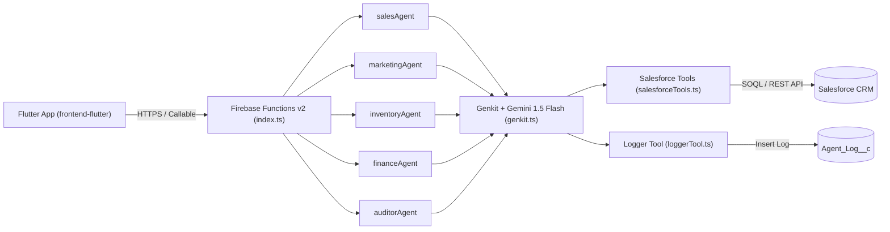

# BizPilot AI

Full-stack Salesforce CRM & Gemini AI multi-agent assistant built with Firebase Functions, Genkit, and Flutter.

## Overview

BizPilot AI connects a cross-platform Flutter client (`frontend-flutter`) to a multi-agent AI backend (`backend-genkit`) powered by **Firebase Functions v2**, **Firebase Genkit**, **Gemini 1.5 Flash**, and **Salesforce CRM**. Specialized agents handle sales, marketing, inventory, finance, and auditing workflows while logging agent activity to Salesforce (`Agent_Log__c`).

## Architecture



## Key Components

- **Frontend (`frontend-flutter`)**: Flutter mobile/web application providing the user interface for interacting with BizPilot AI agents.
- **Backend (`backend-genkit/functions/src/index.ts`)**: Firebase Functions v2 entry point exposing the five specialized agents:
  - `salesAgent`
  - `marketingAgent`
  - `inventoryAgent`
  - `financeAgent`
  - `auditorAgent`
- **AI Configuration (`backend-genkit/functions/src/genkit.ts`)**: Initializes Firebase Genkit with the Gemini 1.5 Flash model.
- **Salesforce Integration (`backend-genkit/functions/src/tools/`)**:
  - `salesforceTools.ts`: Tools for querying and interacting with Salesforce CRM records.
  - `loggerTool.ts`: Logs agent actions and execution details to the `Agent_Log__c` custom object in Salesforce.

## Folder Structure

```text
bizpilot-ai/
├── .github/
│   └── workflows/
│       └── ci.yml              # CI workflow for backend build (Node 18)
├── backend-genkit/
│   ├── .firebaserc
│   ├── firebase.json
│   ├── firestore.rules
│   └── functions/
│       ├── .env.example        # Environment variable template
│       ├── package.json
│       ├── tsconfig.json
│       └── src/
│           ├── config/
│           ├── flows/
│           ├── tools/
│           │   ├── loggerTool.ts
│           │   └── salesforceTools.ts
│           ├── genkit.ts
│           └── index.ts
├── frontend-flutter/           # Flutter client application
├── LICENSE                     # MIT License
└── README.md
```

## Setup & Installation

### Prerequisites

- Node.js 18+
- Firebase CLI (`npm install -g firebase-tools`)
- Flutter SDK
- A Google AI (Gemini) API key and a Salesforce Developer/Sandbox org

### 1. Backend Setup

```bash
cd backend-genkit/functions
npm install
cp .env.example .env
```

Fill in your credentials in `backend-genkit/functions/.env` (see [Environment Variables](#environment-variables)).

### 2. Frontend Setup

```bash
cd frontend-flutter
flutter pub get
flutter run
```

## Environment Variables

Configure the following variables in `backend-genkit/functions/.env` (do not commit `.env` or real secrets):

| Variable | Description | Example / Default |
| --- | --- | --- |
| `GOOGLE_GENAI_API_KEY` | Google Gemini API key for Genkit | `your_google_genai_api_key_here` |
| `SF_LOGIN_URL` | Salesforce OAuth login endpoint | `https://login.salesforce.com` |
| `SF_CLIENT_ID` | Salesforce Connected App Consumer Key | `your_salesforce_client_id_here` |
| `SF_CLIENT_SECRET` | Salesforce Connected App Consumer Secret | `your_salesforce_client_secret_here` |
| `SF_USERNAME` | Salesforce integration username | `your_salesforce_username_here` |
| `SF_PASSWORD` | Salesforce password (plus security token if required) | `your_salesforce_password_and_security_token_here` |

## Testing & Verification

### Backend

```bash
cd backend-genkit/functions
npm run build
```

### Frontend

```bash
cd frontend-flutter
flutter analyze
flutter test
```

## Deployment (Firebase)

```bash
cd backend-genkit
firebase login
firebase deploy --only functions
```

## License

This project is licensed under the MIT License — see the [LICENSE](LICENSE) file for details.
